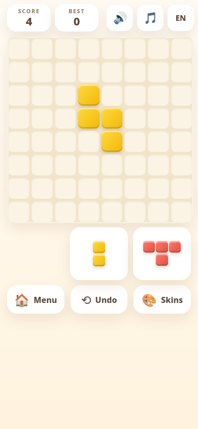

# Color Block

**Current version: v8**

A free, ad-free block puzzle game. Drag pieces onto the 8×8 board, fill full rows
or columns to blast them away, and chain clears for combo multipliers.

🎮 **Play it here: https://color-block.pages.dev/**

## How to play

- Drag one of the three pieces onto the 8×8 board.
- Fill a full row or column to blast it away for points.
- Clear lines on consecutive moves to build a **combo multiplier** (up to ×8).
- Rare 💣 bombs clear a whole 3×3 area.
- Game over when none of your pieces fit — undo is unlimited.

## Features

- 10 block skins (Classic, Neon, Candy, Gems, Sunset, Ocean, Forest, Lava, Mono,
  Glass) + 6 background themes — mix and match freely
- Combo multiplier with a 🔥 streak badge
- 35 piece shapes with friendlier tray deals (you'll never get a hopeless tray)
- **One free second chance per game** — blow open a 3×3 and keep playing
- **Adventure mode** — 20 levels with score/line goals, preset boards, and stars
- **Time attack** — 90 seconds on the clock, every line cleared adds +2s back;
  its best score is tracked separately from the classic best
- **Keyboard & gamepad play** — 1/2/3 pick a piece, arrows/WASD move, Enter
  drops, U undo; gamepad: D-pad/stick + A/B/Y/Start
- **Zen mode** — sort soothing color gradients with harmonic chimes (Web Audio,
  no audio files): daily board, endless boards, shareable seed links, and a
  colorblind symbol overlay (toggle 👁️ or press A)
- English / Español toggle
- Sound effects + gentle background music (mutable)
- Canvas particle explosions on every clear and bomb, Retina-sharp
  (devicePixelRatio-aware), plus a synthesized chord-progression synth —
  multi-line combos climb C → F → G → C↑
- Best score and full game state saved on your device (localStorage) — nothing
  ever leaves your phone
- Zero ads, zero tracking, zero sign-up

## Under the hood

The board logic is a pure, deterministic engine (`src/blast.mjs`): immutable
snapshots power the unlimited undo, and saved games are schema-validated on
load so a corrupt save can never wedge the game. A property/fuzz suite plays
60 seeded games and checks ~86k invariants:

```
node test/property.test.mjs
```

## Run it

Just open `index.html` in a browser, or visit the live link above. No build
step, no dependencies — it's a single self-contained HTML file.

## Screenshot



## License

MIT — see [LICENSE](LICENSE).

---

## Velazquez Lab

More free tools from Cesar Velazquez: [Velazquez Lab](https://velazquez-lab.pages.dev)

- GitHub: https://github.com/crtGhoul
- Codeberg: https://codeberg.org/crtGhoul
- YouTube: https://www.youtube.com/@VelazquezLabs
- Reddit: https://www.reddit.com/user/Manteqaada/
